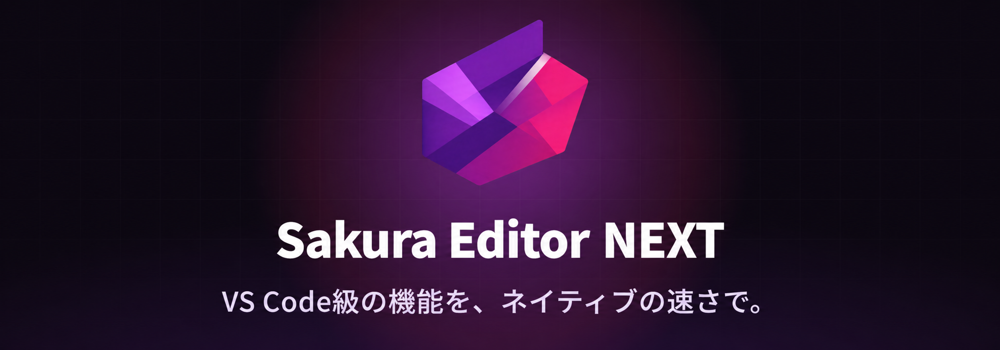

<h1 align="center">
  
</h1>

  サクラエディタを基盤に、VS Code スタイルのワークベンチを Windows ネイティブで実現するテキストエディタ。

  
  
  

  <a href="#ダウンロード">ダウンロード</a> ・
  <a href="#主な特徴">主な特徴</a> ・
  <a href="#基本操作">基本操作</a> ・
  <a href="#terminal">Terminal</a> ・
  <a href="#gitgithub-機能">Git・GitHub</a> ・
  <a href="#拡張機能senp">拡張機能</a> ・
  <a href="#プロジェクト情報">プロジェクト情報</a>

## ダウンロード

> [!IMPORTANT]
> Sakura Editor NEXT は **Windows 11 build 22000 以降の x64 環境専用**です。x86 版および Windows 10 はサポートしません。CPU は AVX に対応している必要があります。

| 種類 | 入手先 | 内容 |
| --- | --- | --- |
| 開発版 | [GitHub Actions](https://github.com/tsuyoshi-otake/sakura-editor-next/actions/workflows/build-sakura.yml?query=branch%3Amain) | `main` の最新ビルド |
| リリース版 | [Releases](https://github.com/tsuyoshi-otake/sakura-editor-next/releases) | 公開済みの配布パッケージ |

ソースからビルドする場合は [CONTRIBUTING.md](./CONTRIBUTING.md) を参照してください。

## 主な特徴

- **VS Code と同じワークベンチ構成** — Activity Bar、Primary Side Bar、エディター、Panel、Secondary Side Bar を 1 つのウィンドウにまとめています。
  - **Primary Side Bar**（既定で表示、左）: Activity Bar のアイコンで Explorer、Search、Source Control、Extensions を切り替えます。既定でインストール済みの組み込み拡張機能の Projects、GitHub（Pull Requests／Issues）、GitHub Actions のアイコンも並びます。Outline は Explorer の中の View で、独立した Side Bar ではありません。
  - **Panel**（既定で非表示、下）: Problems、Output、Terminal を切り替えます。
  - **Secondary Side Bar**（既定で非表示、右）: 既定では空です。Activity Bar のアイコンまたは Side Bar のタイトルをドラッグして、コンテナーを移動できます。
- **必要なときだけ起動する Terminal** — Terminal は初めて使うまで起動しません。
- **コマンドパレット** — <kbd>Ctrl</kbd>+<kbd>Shift</kbd>+<kbd>P</kbd> で開きます。
- **言語の自動判定** — ファイル名、ファイル名パターン、拡張子の順に判定し、どれにも一致しないときだけ先頭行を使います。VS Code の言語関連付けと同じ優先順位です。
- **複数ウィンドウ** — エディターウィンドウは同時に 16 個まで開けます。17 個目は起動に失敗します。
- **サクラエディタ由来の編集基盤** — 実績ある編集機能を引き継ぎながら、Windows 11 向けの x64 ネイティブアプリとして発展させています。
- **起動時の CPU 最適化** — x64 Release 版は単一の `sakura.exe` で、起動時に AVX、AVX2、AVX-512F/BW のうち使える最上位の実装を一度だけ選びます。

> [!NOTE]
> Run and Debug、Ports、Debug Console、Remote Development は未対応です。

## 基本操作

| 操作 | ショートカット |
| --- | --- |
| Primary Side Bar の表示／非表示 | <kbd>Ctrl</kbd>+<kbd>B</kbd> |
| Panel の表示／非表示 | <kbd>Ctrl</kbd>+<kbd>J</kbd> |
| Secondary Side Bar の表示／非表示 | <kbd>Ctrl</kbd>+<kbd>Alt</kbd>+<kbd>B</kbd> |
| コマンドパレット | <kbd>Ctrl</kbd>+<kbd>Shift</kbd>+<kbd>P</kbd> |
| Extensions を開く | <kbd>Ctrl</kbd>+<kbd>Shift</kbd>+<kbd>X</kbd> |
| Terminal の表示／フォーカス | <kbd>Ctrl</kbd>+<kbd>@</kbd>（英語配列では <kbd>Ctrl</kbd>+<kbd>&#96;</kbd>） |
| 最近開いた項目（Open Recent） | <kbd>Ctrl</kbd>+<kbd>R</kbd> |
| エディターを閉じる | <kbd>Ctrl</kbd>+<kbd>W</kbd> |
| Markdown プレビューの切り替え（Terminal では貼り付け） | <kbd>Ctrl</kbd>+<kbd>Shift</kbd>+<kbd>V</kbd> |
| Markdown プレビューを横に開く | <kbd>Ctrl</kbd>+<kbd>K</kbd> のあとに <kbd>V</kbd> |
| フォルダーを開く | <kbd>Ctrl</kbd>+<kbd>K</kbd> のあとに <kbd>Ctrl</kbd>+<kbd>O</kbd> |
| すべて保存 | <kbd>Ctrl</kbd>+<kbd>K</kbd> のあとに <kbd>S</kbd> |
| フォルダーを閉じる | <kbd>Ctrl</kbd>+<kbd>K</kbd> のあとに <kbd>F</kbd> |
| 表示の拡大／縮小／リセット | <kbd>Ctrl</kbd>+<kbd>+</kbd> ／ <kbd>Ctrl</kbd>+<kbd>-</kbd> ／ <kbd>Ctrl</kbd>+<kbd>0</kbd> |

- <kbd>Ctrl</kbd>+<kbd>K</kbd> を押したあと、5 秒以内に次のキーを押してください。
- Terminal にフォーカスがあるときは、<kbd>Ctrl</kbd>+<kbd>B</kbd>、<kbd>Ctrl</kbd>+<kbd>J</kbd>、<kbd>Ctrl</kbd>+<kbd>R</kbd>、<kbd>Ctrl</kbd>+<kbd>W</kbd>、<kbd>Ctrl</kbd>+<kbd>Shift</kbd>+<kbd>X</kbd> など一部のショートカットはワークベンチではなくシェルに送られます。先にエディターや Explorer へフォーカスを戻してから押してください。一方、<kbd>Ctrl</kbd>+<kbd>K</kbd> で始まる連続キー、<kbd>Ctrl</kbd>+<kbd>Shift</kbd>+<kbd>P</kbd>、表示の拡大／縮小／リセットは、Terminal にフォーカスがあってもワークベンチが処理します。

## Terminal

Panel の Terminal は、次の順でシェルを選びます。

1. ユーザーが指定したプロファイル
2. インストール済みの安定版 PowerShell のうち最も新しいもの
3. Windows PowerShell 5.1（PowerShell 7 がない環境）

ネットワークへの問い合わせや自動インストールは行いません。

### キーボードとマウス

| 操作 | 動作 |
| --- | --- |
| <kbd>Ctrl</kbd>+<kbd>C</kbd> | 選択範囲があればコピーして選択を解除します。なければ割り込み（`^C`）をシェルへ送ります |
| <kbd>Ctrl</kbd>+<kbd>Shift</kbd>+<kbd>C</kbd>、<kbd>Ctrl</kbd>+<kbd>Insert</kbd> | 選択範囲をコピーします。`^C` はシェルへ送られません |
| <kbd>Ctrl</kbd>+<kbd>V</kbd>、<kbd>Ctrl</kbd>+<kbd>Shift</kbd>+<kbd>V</kbd>、<kbd>Shift</kbd>+<kbd>Insert</kbd> | 貼り付けます |
| 右クリック | 選択範囲があればコピーして選択を解除します。なければ貼り付けます |
| <kbd>Shift</kbd>+右クリック | TUI アプリがマウス操作を受け取っているときでも、右クリックと同じコピー／貼り付けを行います |
| ダブルクリック | 単語を選択します。区切り文字は VS Code の既定値で、変更はできません |
| <kbd>Ctrl</kbd>+クリック | カーソル下の `http://`／`https://` の URL を開きます |

Claude Code のように TUI アプリがマウス操作を受け取っているとき、<kbd>Shift</kbd> なしの右クリックはアプリへ渡されます。TUI アプリが OSC 52 でクリップボードへ書き込む操作には対応していますが、クリップボードの読み取り要求には応答しません。

### 既定で有効な GNU Screen 風のプレフィックス

Terminal のメニュー［ショートカット］は、既定で「GNU Screen (Ctrl+A)」です。このため <kbd>Ctrl</kbd>+<kbd>A</kbd> は Terminal が受け取り、readline の行頭移動は届きません。<kbd>Ctrl</kbd>+<kbd>A</kbd> を 2 回押すと `^A` をシェルへ送ります。以前の動作に戻すには、［ショートカット］から「なし」を選びます。「tmux (Ctrl+B)」も選べます。

### 画像の貼り付け

クリップボードに画像だけがあるとき（Win+Shift+S のスクリーンショットなど）、Terminal への貼り付けは PNG を一時保存し、その絶対パスを入力します。Claude Code、Codex、Cursor CLI など、画像を**ファイルパス**として受け取るツール向けの動作です。

- 保存先: `%TEMP%\sakura-editor\terminal-paste\`
- 同じ会話で複数枚貼っても、ファイル名は都度別になります
- 直近 32 枚だけ残し、古い PNG は自動で削除します
- クリップボードに通常のテキストがある場合は、従来どおりテキストを優先して貼ります
- Explorer でコピーしたファイルがある場合は、そのパスを貼ります

Stock の VS Code 統合 Terminal にはない Sakura 独自の補助機能です。

## Git・GitHub 機能

表示や接続に問題があるときは、[Git・GitHub 機能のトラブルシューティング](./docs/user/git-github-cli-troubleshooting.md)で原因と確認方法を確認できます（[English](./docs/user/git-github-cli-troubleshooting.en.md)・[简体中文](./docs/user/git-github-cli-troubleshooting.zh-CN.md)）。

- **Source Control** — Git が見つからないと、「Git が見つかりません。Git for Windows をインストールし、git.exe を PATH に追加してから Sakura Editor NEXT を再起動してください。」と表示され、［詳細］からガイドを開けます。
- **GitHub Pull Requests／Actions の View** — 表示できない状態では、「このビューを表示できません。［拡張機能］で拡張機能の状態を確認してください。」と表示され、［詳細］からガイドを開けます。GitHub CLI が見つからないときは、この文の下に「GitHub CLI が見つかりません。導入または PATH を確認してください。」も表示されます。この 2 つの View では、［詳細］は表示できない状態のときだけ表示されます。これらの View が使う GitHub CLI はバージョン 2.93.0 だけです。
- **Accounts メニュー** — Accounts（既定の縦型 Activity Bar では下部）には、Git の `user.name`／`user.email` と、GitHub CLI（`gh auth status`）で確認できたアカウントが表示されます。GitHub CLI は GitHub, Inc. の署名を確認できたものだけを起動します。Sakura Editor NEXT の画面にサインイン操作はありません。

## 拡張機能（SENP）

Activity Bar の拡張機能アイコン、または <kbd>Ctrl</kbd>+<kbd>Shift</kbd>+<kbd>X</kbd> で Extensions View を開きます。SENP は Sakura Editor NEXT 独自のローカルパッケージ形式です。Marketplace、検索、自動更新はありません。

- **組み込み拡張機能** — インデントの色分け、各言語の構文強調、Projects、GitHub Pull Requests（Issues を含む）、GitHub Actions は既定でインストール済みです。行の［アンインストール］で外し、［インストール］でネットワークなしに戻せます。
- **開発用パッケージ** — Extensions View のタイトルメニューにある［SENP パッケージからインストール...］、または `.senp` ファイルのドラッグ＆ドロップで導入します。発行元による信頼確認がないため、確認ダイアログで［はい］を選んだときだけ有効になります。［いいえ］では無効のままインストールされます。
- **行ごとの操作** — 組み込み以外のインストール済みパッケージには［有効化］／［無効化］と［アンインストール］が表示されます。VS Code と同じく、アンインストールは確認なしで実行されます。
- **状態表示** — 問題のあるパッケージは、その行だけに「エラー」（読み取れない）、「互換性のないランタイム」、「このウィンドウではサポートされていません」、「競合」のいずれかが表示されます。ほかの拡張機能は影響を受けずに動作します。読み取れない行は［アンインストール］で削除できます。
- **実行中の失敗** — インデントの色分けのように行の装飾を計算する拡張機能は、実行中に失敗しても自動で再起動します。5 分以内に 3 回失敗すると停止し、その理由が Extensions View の診断表示に英語で表示されます。停止した拡張機能は、パッケージを更新するかエディターを再起動すると戻ります。ほかの拡張機能の装飾は続きます。

パッケージ形式と `sakura-senp-tool` の使い方は [SENP パッケージ形式](./docs/senp-package-format.md) を参照してください。

## プロジェクト情報

| 項目 | リンク |
| --- | --- |
| ビルド・テスト・起動計測・コントリビュート | [CONTRIBUTING.md](./CONTRIBUTING.md) |
| セキュリティ | [GitHub Security Advisories](https://github.com/tsuyoshi-otake/sakura-editor-next/security/advisories) |
| SENP パッケージ仕様・開発ガイド | [docs/senp-package-format.md](./docs/senp-package-format.md) |
| 最新の変更 | [コミット履歴](https://github.com/tsuyoshi-otake/sakura-editor-next/commits/main/) ・ [Releases](https://github.com/tsuyoshi-otake/sakura-editor-next/releases) |
| 引き継いだ変更履歴 | [CHANGELOG.md](./CHANGELOG.md) |
| ライセンス | [zlib License](./LICENSE) |
